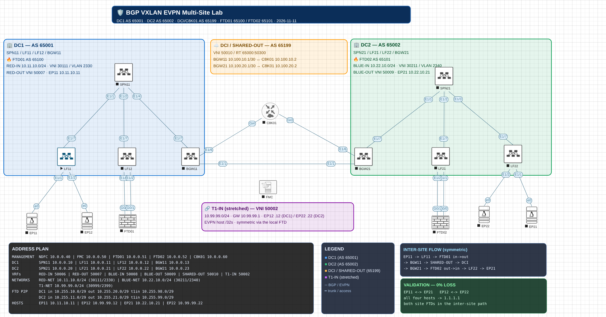
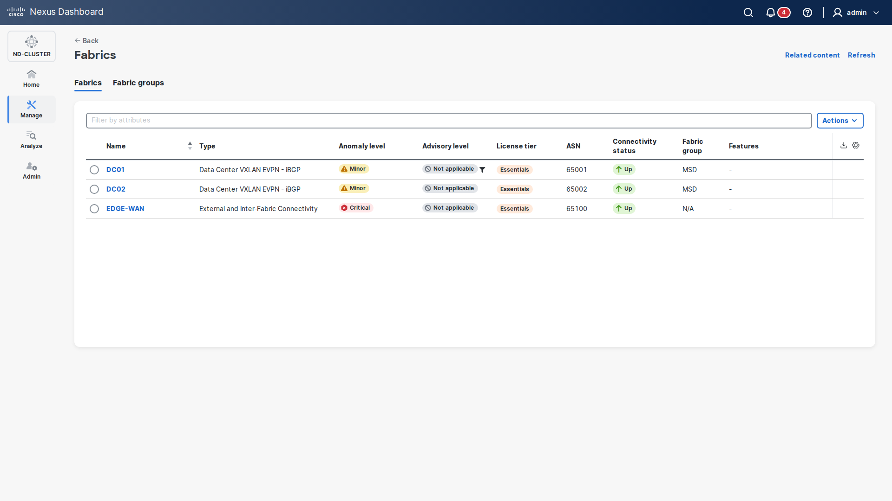
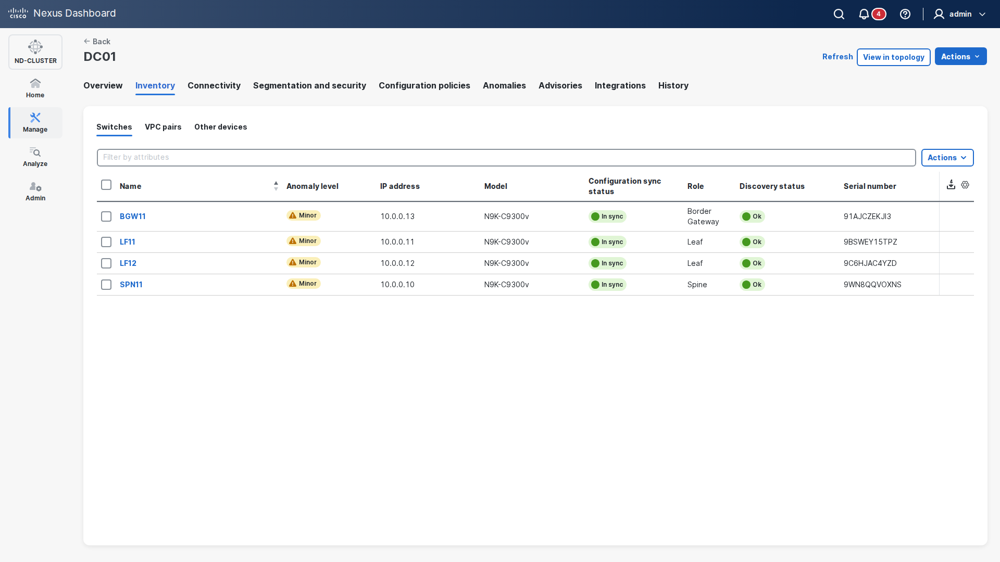
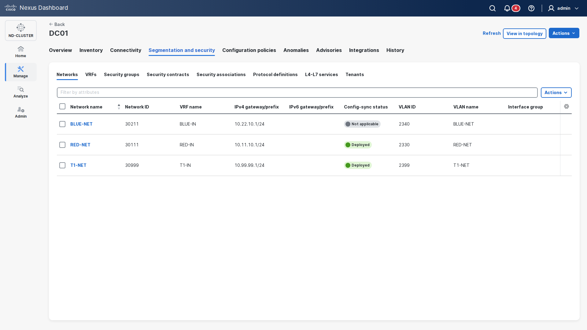
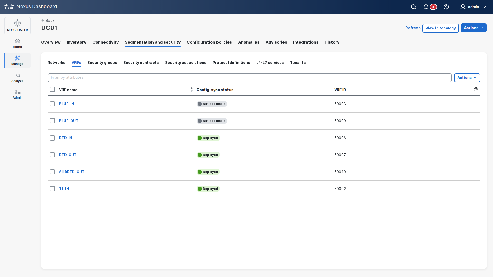

# BGP VXLAN EVPN Multi-Site Lab

Two-site Cisco VXLAN EVPN **Multi-Site** lab built in EVE-NG, managed with
**Cisco NDFC** (fabric) and **Cisco FMC** (standalone FTDv firewalls), with a
**VRF sandwich** and **EVPN Type-5 DCI**.

The design goal is simple: **every inter-site flow traverses both site-local
firewalls in both directions**, while north-south traffic uses the firewall of
the site the host lives in.



## What is in the lab

| Site | Spine | Leafs | Border GW | Firewall | Fabric AS |
|---|---|---|---|---|---|
| DC1 | SPN11 | LF11, LF12 | BGW11 | FTD01 (AS 65100) | 65001 |
| DC2 | SPN21 | LF21, LF22 | BGW21 | FTD02 (AS 65101) | 65002 |
| DCI / edge | — | — | — | C8K01 (AS 65199) | — |

- **EVPN Multi-Site**: DC01 and DC02 are member fabrics of the `MSD` fabric.
- **DCI**: routed eBGP between BGW11 and BGW21, with SHARED-OUT L3VNI 50010
  (RT `65000:50300`) over the Multi-Site DCI.
- **VRF sandwich**:
  - DC1: `RED-IN` → FTD01 → `RED-OUT` → `SHARED-OUT`
  - DC2: `BLUE-IN` → FTD02 → `BLUE-OUT` → `SHARED-OUT`
- **Stretched VRF**: `T1-IN` (VNI 50002, RT `65000:50099`) is stretched across
  both sites; `T1-NET` `10.99.99.0/24` (VNI 30999, VLAN 2399) hosts EP12/EP22.
- **Distributed anycast gateway**: the same IP/MAC on every leaf, so each host
  always uses its **local** leaf gateway and its **local** FTD.
- **Hosts**: four Debian 12 VMs (EP11, EP12, EP21, EP22) on a custom
  `linux-host` image.

## NDFC screens

| | |
|---|---|
|  |  |
|  |  |

More views (DC01 overview, policies, topology, DC02) in
[`ndfc/screenshots/`](ndfc/screenshots/).

## Address / ASN quick reference

| Item | Value |
|---|---|
| DC1 fabric AS | 65001 |
| DC2 fabric AS | 65002 |
| FTD01 / FTD02 AS | 65100 / 65101 |
| C8K01 AS | 65199 |
| RED-IN / RED-OUT | VNI 50006 / 50007 |
| BLUE-IN / BLUE-OUT | VNI 50008 / 50009 |
| SHARED-OUT | VNI 50010 |
| T1-IN (stretched) | VNI 50002 |
| RED-NET | 10.11.10.0/24, VNI 30111, VLAN 2330 |
| BLUE-NET | 10.22.10.0/24, VNI 30211, VLAN 2340 |
| T1-NET | 10.99.99.0/24, VNI 30999, VLAN 2399 |
| Hosts | EP11 `10.11.10.11`, EP12 `10.99.99.12`, EP21 `10.22.10.21`, EP22 `10.99.99.22` |

Full tables: [`docs/ip-plan.md`](docs/ip-plan.md).

## Validation (live, 0% loss)

| Flow | Result |
|---|---|
| EP11 ↔ EP21 (RED-IN ↔ BLUE-IN) | 0% both ways, **both FTDs in path** |
| EP12 ↔ EP22 (T1-IN stretched) | 0% both ways |
| EP11 / EP21 / EP12 / EP22 → 1.1.1.1 | 0% (each via its **site-local** FTD) |
| NDFC DC01 + DC02 | **8/8 switches In-Sync** |

Firewall proof for the inter-site flow:

```
FTD01: ICMP inside  10.11.10.11  outside 10.22.10.21
FTD02: ICMP outside 10.11.10.11  inside  10.22.10.21
```

## Repository layout

```
.
├── README.md
├── topology/
│   ├── topology.png              # annotated EVE-NG topology
│   └── BGP_VXLAN_EVPN.unl        # EVE-NG lab file (sanitised)
├── configs/
│   ├── nxos/                     # SPN11/21, LF11/12/21/22, BGW11/21
│   ├── c8k01/                    # C8K01 running-config
│   └── ftd/                      # FTD01/02 running-config
├── ndfc/                         # NDFC fabrics, VRFs, networks, policies, sync
│   └── screenshots/              # NDFC UI captures
└── docs/
    ├── architecture.md
    ├── ip-plan.md
    ├── build-guide.md
    ├── validation.md
    ├── troubleshooting.md
    └── linux-host-image.md
```

## Prerequisites

- EVE-NG 6.x with NX-OSv 10.6(3), C8000V 17.15, FTDv, and the
  `linux-host` Debian image.
- Cisco NDFC 4.2.x with the `MSD`, `DC01`, `DC02`, and `EDGE-WAN` fabrics.
- Cisco FMC managing the two standalone FTDv.
- Management network `10.0.0.0/24` for NDFC/FMC/FTDs/C8K01.

## Quick start

1. Import `topology/BGP_VXLAN_EVPN.unl` into EVE-NG (same path
   `/Users/<user>/BGP_VXLAN_EVPN.unl`).
2. Build/import the `linux-host` image (see `docs/linux-host-image.md`).
3. Onboard the switches into NDFC (`MSD` → `DC01`/`DC02`) and the FTDs into FMC.
4. Apply the NDFC freeform policies (see `docs/build-guide.md` and
   `ndfc/effective_policies_*.json`).
5. Set the host IPs from `docs/ip-plan.md`.
6. Run the tests in `docs/validation.md`.

## Security note

All passwords, SNMP communities, keys, and pre-shared secrets in the exported
configs are replaced with `<REDACTED>`. The EVE-NG lab file has the credentials
text box removed. Use your own lab credentials.

## Documentation

- [Architecture](docs/architecture.md)
- [IP / ASN / VNI plan](docs/ip-plan.md)
- [Build guide](docs/build-guide.md)
- [Validation](docs/validation.md)
- [Troubleshooting / gotchas](docs/troubleshooting.md)
- [Linux host image](docs/linux-host-image.md)

## Disclaimer

This is a lab/reference design. It is not a production hardening guide.
